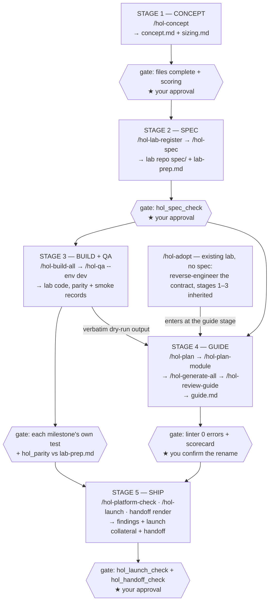

# holagent — Project Summary

> Prepared for a project briefing. Covers what holagent does, the sub-agents,
> the scoring system, and the end-to-end flow.

---

## 1. Executive summary

**holagent** is a Pi agent package (`holagent-lab-guides`) that runs the entire
Dell Hands-on Lab (HOL) lifecycle end-to-end, from idea to launch collateral:

```
concept → spec → build → QA → guide → ship
```

It turns a manual, multi-person, memory-driven job into an **agent-driven
pipeline with a deterministic gate at every stage**. You interview with the
tool once per stage; the agents do the drafting, building and reviewing; and
nothing advances on an agent's opinion — each stage ends at (a) a
deterministic check (exit codes, file structure, cross-document agreement),
(b) a rubric scorecard, and (c) you.

**The problem it solves.** Producing a lab is roughly a nine-step job —
brainstorm the story, shrink the footprint, write a build spec, build it, write
the guide, QA it, fit it to the platform team's rules, do production QA, then
advertise it. Every step is manual, every step depends on one person's memory
of an unwritten house standard, and most existing labs have **no spec documents
at all**. The result is the drift visible in the in-house sample guides: broken
TOC numbering, stale anchors, credentials in the body that no longer match the
credentials block, `Module` vs `Phase` headings.

**The value is not only speed.** It delivers three things a manual process
cannot:

1. **An executable house standard** — the format rules, style and rubrics are
   enforced by a linter and scorers, not remembered.
2. **A machine-readable environment contract** (`lab-prep.md`) — "the guide
   matches the lab" becomes a test (`hol_parity`), not an opinion.
3. **A compounding platform knowledge base** — platform requirements are
   interviewed into a file that grows after every meeting, instead of living as
   tribal knowledge.

**Two design commitments make it trustworthy rather than merely fast:**

- **State lives in files, never in the conversation.** You can `/clear`
  freely between stages; every command re-detects where it is from disk
  (`.holagent/`) and resumes.
- **Determinism is never mediated by a model.** The linter, the state machine,
  the spec/contract checks, the milestone tests and the parity runs all live in
  unit-tested TypeScript that the model *calls* but cannot *interpret away*.

**Fast facts**

| | |
|---|---|
| Package | `holagent-lab-guides` v0.3.0, a Pi agent package, zero runtime dependencies |
| Shape | 5 lifecycle stages · 22 prompt-driven slash commands + 2 no-LLM commands |
| Agents | 12 types (11 writers + 1 scorer, instantiated in parallel) |
| Scoring | 26 rubrics · 10 scopes · 3 families (checklist / analytic / holistic) |
| Gates | 25-rule linter + 13 deterministic extension tools |
| Decisions | 23 ADRs (architecture decision records), indexed and immutable |
| Scale | ~12.7k lines of extension TypeScript, ~8k lines of tests (293 tests, green) |
| Scope | Built for Dell HOLs on vCD and Kubernetes, many concurrent instances per lab |

**What is deliberately out of scope:** provisioning the environment itself,
capturing screenshots, and publishing to the lab catalogue. Production QA is a
human act — the tool renders a read-only script for a person to run and records
what they report; it never executes against production.

---

## 2. The general flow — five stages



The key shape: **an approved spec unblocks two independent tracks.** The build
track and the guide track run in parallel; they meet where QA's captured
verbatim command output becomes the guide's expected results — so the guide can
never claim an output nobody actually saw.

The **adoption path** (`/hol-adopt`) is the on-ramp that matters in practice:
most HOL environments already exist with no spec, so `lab-surveyor`
reverse-engineers the environment contract from the repo's deployment artifacts
and a read-only look at a running dev instance, you confirm it row by row, and
stages 1–3 are recorded as *inherited* rather than fabricated.

---

## 3. Architecture — four layers

**Prompts orchestrate, subagents work, skills carry knowledge, the extension
carries determinism.**

| Layer | What it is | Role |
|---|---|---|
| **Prompts** (22) | Slash-command templates run by the parent session | Interview → dispatch → gate → fix-loop → merge → report → next command |
| **Agents** (12) | `holagent.*` subagents, isolated (`maxSubagentDepth: 0`) | Do one bounded job, write one artifact, return a summary + open questions |
| **Skills** (14) | Knowledge directories | Formats, methods, rubrics, templates, the style corpus |
| **Extension** | Deterministic TypeScript (13 tools + 25-rule linter) | Every gate; the model calls it but cannot reinterpret its verdict |
| **Files** | `~/.holagent/`, the guide root, the lab repo (via `lab-ref.json`) | The only durable state |

**Two hard architectural rules:**

- **No agent-to-agent handoff exists.** All agents run with
  `maxSubagentDepth: 0`, `inheritProjectContext: false`, `inheritSkills: false`.
  The parent session is the only integration point, and the filesystem is the
  durable handoff medium.
- **Write confinement.** The package writes only under `~/.holagent/` and the
  active guide root. A lab's own repository is reached only through a
  `lab-ref.json` the user confirms once — and even there, only two named tools
  may write, only fixed paths, and never overwrite a file they did not generate.

---

## 4. The sub-agents — deep dive

There are **11 writer agents**, each with a single bounded job, plus **1 scorer
agent template** instantiated many times in parallel. Every writer shares the
same contract:

- **Does not interview** — works strictly from the confirmed answers the parent
  relays in the task payload.
- **Writes exactly the artifact(s) it is told to write**, nothing else.
- **Returns** a draft summary + open questions (what it couldn't source).
- **Local files only** — no network commands, and (for surveyor/QA) read-only or
  dev-only probing.
- **Never invents** — anything it cannot source becomes an open question, not a
  guessed value.

### 4.1 The writer agents, in lifecycle order

| Agent | Stage | Writes | What it does |
|---|---|---|---|
| **concept-author** | 1 · Concept | `.holagent/concept.md` | Turns interview answers into the demo story — business problem, personas, 3–5 story beats (action + observation), and the aha moment. Every claim must survive "compared to what?" and "how would the learner see that?". |
| **sizing-architect** | 1 · Concept | `.holagent/sizing.md` | Shrinks the solution to the smallest footprint that still demonstrates it. Production footprint honestly first, then cut to the story beats, then density maths (per-instance, target N, and *what runs out first, at what N*). Every reduction row says what breaks if made smaller. |
| **spec-author** | 2 · Spec | lab repo `spec/01…10` + `lab-prep.md` | Turns approved concept + sizing into a ten-section build contract an autonomous agent can work from. Interfaces, schemas and config shapes — no code. Nothing may contradict the concept or sizing. |
| **lab-builder** | 3 · Build | lab repo code + tests | Implements exactly one milestone of the build sequence, in the lab's own repo, and leaves it passing its own declared test. Pins what the spec pinned, never commits, never touches the lab environment. |
| **qa-runner** | 3 · QA | captured dry-run output | Stands the built lab up on its **dev** environment and exercises it end to end, capturing verbatim command output that becomes the guide's expected results. Finds what parity structurally cannot — does the lab actually do what the spec said. Dev only, never fixes the lab, leaves the environment as found. |
| **guide-planner** | 4 · Guide | `plan.md` + `lab-prep.md` | Drafts the guide plan (frontmatter is the machine source of truth: ID, modules, duration) and the environment contract. |
| **module-planner** | 4 · Guide | `.holagent/<NN-slug>/plan.md` | Plans one module — step outline, commands, expected outputs, image checklist, success criteria. The frontmatter is the contract the implementer, linter and scorers rely on. |
| **guide-implementer** | 4 · Guide | one `## Module N:` section | Authors one module's prose — real commands, verbatim expected outputs, checkpoints, screenshot placeholders. Never touches another module; self-checks with the linter. |
| **lab-surveyor** | Adoption | `lab-prep.md` + `sizing.md` (observed) | Reverse-engineers the environment contract for an existing lab from repo artifacts + read-only observation of a dev instance. Every row cites its evidence; never invents a version or a path. |
| **platform-reviewer** | 5 · Ship | `.holagent/platform/<name>.json` | Reviews a lab against the platform team's *written* requirements only, producing severity-tagged findings (blocker / should-fix / note) plus a pre-meeting brief. Reports only, never changes the lab. |
| **launch-writer** | 5 · Ship | `launch/` (exec summary, catalogue, social, optional SE brief) | Describes a finished lab to people who will never read it, using only things the lab actually does. Every claim must name its source or it does not go in. |

### 4.2 The scorer

`scorer` is a **read-only** agent (no bash/write/edit tools — by design). One
scorer instance = **one rubric × one content slice**. It is fanned out in
parallel across every rubric of the scope being reviewed, then terminated. See
§5 for the full scoring machinery.

---

## 5. The scorers — deep dive

Judgment that a deterministic gate *cannot* make — "is this step clear?", "is
this story coherent?" — is delegated to a parallel fanout of read-only scorer
agents, each judging one rubric against one slice of content.

### 5.1 Three rubric families

| Kind | Score unit | Entry score | Passes when |
|---|---|---|---|
| **checklist** | binary criterion (met / not met) | pass rate 0–1 | score ≥ threshold (default 1.0 — must be perfect) |
| **analytic** | 1–5 per criterion (anchored) | mean of criteria | mean ≥ threshold (default 4) **and** every criterion ≥ 3 |
| **holistic** | single 1–5 overall (anchored) | that score | score ≥ threshold (default 4) |

Anchors are fixed: **5** = fully met, exemplary · **3** = partially met, a real
gap · **1** = absent or wrong. A between-anchor score (e.g. 4) is allowed only
with a concrete finding naming the blemish. "Mostly there" is *not* met for a
checklist criterion.

### 5.2 The ten scopes and their 26 rubrics

| Scope | Rubrics | Count |
|---|---|---|
| **concept** | concept-completeness (c) · business-value (a) · story-coherence (h) | 3 |
| **sizing** | footprint-realism (a) | 1 |
| **spec** | spec-completeness (c) · spec-buildability (a) · spec-coherence (h) | 3 |
| **build** | milestone-completeness (c) · spec-fidelity (a) | 2 |
| **plan** | plan-completeness (c) · environment-alignment (a) · learning-arc (a) · plan-coherence (h) | 4 |
| **module-plan** | module-plan-completeness (c) · module-design (a) | 2 |
| **module** | module-completeness (c) · step-clarity (a) · technical-accuracy (a) · module-quality (h) | 4 |
| **guide** | guide-completeness (c) · terminology-consistency (a) · guide-quality (h) | 3 |
| **platform** | platform-coverage (c) · finding-actionability (a) | 2 |
| **launch** | launch-completeness (c) · claim-traceability (a) | 2 |

*(c = checklist, a = analytic, h = holistic.)*

### 5.3 The scorer contract

Every scorer ends its reply with **exactly one fenced JSON block and no prose
after it** — the parent extracts the last fenced block, validates the shape,
**recomputes** the entry score/status from the criterion scores (defense in
depth), and merges via the `hol_scores` tool. Key rules:

- Criterion scores are integers 1–5 (analytic/holistic) or 0/1 (checklist);
  both `score` fields are JSON numbers, never quoted strings.
- `criterion` is copied **verbatim** from the rubric; `finding` is `null` on a
  full pass, otherwise a concrete file+line location.
- On parse failure the parent retries that one scorer **once**; still
  unparseable → recorded `escalated`, never guessed.

**Fix loops.** Failing entries drive a capped fix loop. Analytic/holistic
rubrics cap at **3 rounds**; checklist gates escalate after **5** unproductive
rounds (no improvement across 2 consecutive). A fix round **rescores every
rubric of the scope**, not just the failed subset — the edit touched content
all of them read. Anything that hits its cap is recorded `escalated` and
surfaced to you rather than silently accepted.

**The v0.3.0 scoring mechanics** (ADR-019/020): the fanout runs as one parallel
`runs.all` wave with path-based tasks (~2.4× faster per round), and analytic
criteria gained a **floor** — a criterion scored 1 or 2 fails the entry
whatever the mean, so a weak section can no longer be averaged away.

---

## 6. The deterministic gates

Anything a machine *can* decide is kept out of model judgment and put in
unit-tested TypeScript (ADR-007). The extension registers **13 tools**, plus
two no-LLM slash commands:

| Tool / command | Decides |
|---|---|
| `hol_validate` / `/hol-validate` | Runs the 25-rule linter (no model in the path) |
| `hol_status` / `/hol-status` | Plan validity, per-module states, next command |
| `hol_scores` | Atomic read/merge/clear of `scores.json` |
| `hol_spec_check` | Spec set has all 10 sections, no `<< FILL: >>`, populated open-questions |
| `hol_prep_check` | `lab-prep.md` frontmatter parses, all 7 keys named and filled, verifiable checks |
| `hol_platform_findings` | Platform findings are severity-tagged, traced, owned, closed |
| `hol_build_test` | Runs one milestone's own declared test command |
| `hol_parity` | Executes `lab-prep.md`'s `verify` checks against a **dev** env (refuses prod — no override) |
| `hol_qa_script` | Renders the same checks as a read-only script for a human |
| `hol_qa_record` | Records a human's smoke / production QA outcome |
| `hol_launch_check` | Launch collateral exists, complete, and agrees with `plan.md` on ID/title/duration |
| `hol_handoff_render` | Assembles the platform handoff (deterministic, no agent) |
| `hol_handoff_check` | Gates the handoff: Mermaid parses, digests match manifests, secret-free |

The **linter** is line-based (no Markdown AST, no build step) and enforces the
house format — 25 rules covering the H1/TOC/anchor skeleton, module numbering,
callouts, image proxy syntax, credentials matching the credentials block,
command extraction, and optional `shellcheck` on inline commands.

### The ADRs — the design in one sentence

23 architecture decision records underpin the whole thing. Read together they
are one idea applied everywhere: **decide mechanically what can be decided
mechanically, and be honest about the rest.** Where the package cannot know
something — an adopted lab's business case, a platform rule nobody stated, a
claim with no source — the design makes the gap *visible* rather than filling
it. The second idea: safety boundaries live in code, not prose — the dev/prod
split (ADR-012) and write confinement (ADR-008) are enforced in `hol-core.ts`,
where a prompt cannot argue past them.

---

## 7. The Kubernetes extension (newest work)

Merged from `feat/k8s-ext`, this extends the lifecycle for labs deployed on
**Charmed Kubernetes** with GitLab + Argo CD, and adds the platform-neutral
**handoff renderer** as a first platform adapter.

- **`extensions/k8s/`** — deployment-profile contract, a deterministic raw-YAML
  generator, one-GitLab-project-per-lab provisioning, Argo exact-revision
  readiness, operation idempotency, policy-driven test orchestration (including
  a six-test VirtualServer runner), evidence-bearing UAT/promotion, and
  digest-bound GitOps rollback.
- **The platform handoff** (`hol_handoff_render` / `hol_handoff_check`) — a
  deterministic renderer (no agent, byte-identical output) that assembles
  `handoff/k8s.md` from recorded artifacts: `lab-ref.json`, `lab-prep.md`,
  `sizing.md`, `deployment-profile.yaml`, committed manifests, and platform
  findings. The Kubernetes dialect is bound to committed manifests by digest;
  the vCD dialect is specified but deferred (ADR-022).
- **Milestone 10 was dropped** (ADR-023) and the live-environment transitions
  deliberately **fail closed** — every path needing an unresolved dependency
  (admin policy, credentials, approval) returns `BLOCKED_*` rather than guessing.

The whole extension is contract/integration/E2E tested with injectable fakes
(`InMemoryGitLab`, `SupplierArgo`, VirtualServer probe transport); the pilot
rehearsal exercises dev deploy → UAT promotion → production promotion → rollback.
Existing holagent behaviour is unchanged when Kubernetes is not selected.

---

## 8. Current maturity and known gaps

- **Green battery:** 293 tests pass (typecheck + unit/integration/E2E), corpus
  regression over four in-house sample guides, package smoke test, and a real
  guide carried end-to-end through the original pipeline.
- **Biggest remaining manual step:** the screenshot loop — guides emit
  `<< INSERT SCREENSHOT: … >>` placeholders a human fills by hand.
- **Roadmap items:** share the `~/.holagent/` platform knowledge base across the
  team, pin `holagent.scorer` to a cheaper model for cost, schedule parity runs
  for guide-rot detection, and eventually add provisioning (stage 0) and
  catalogue publishing (stage 6).
